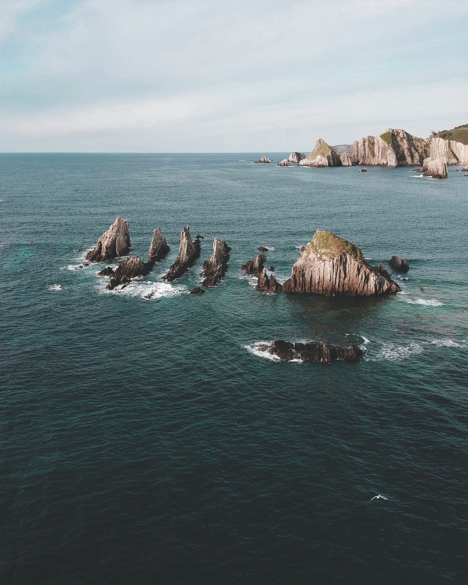
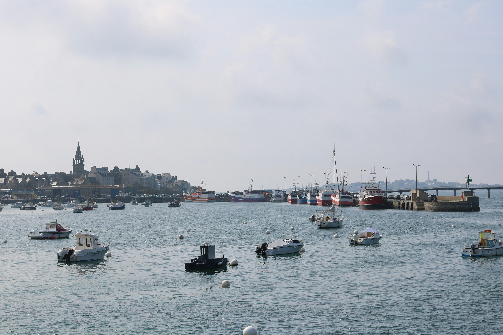
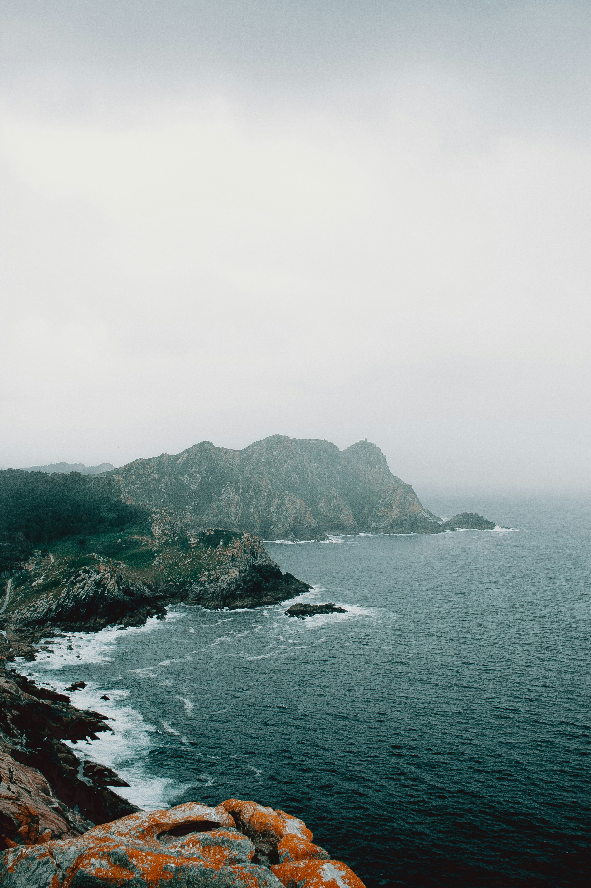
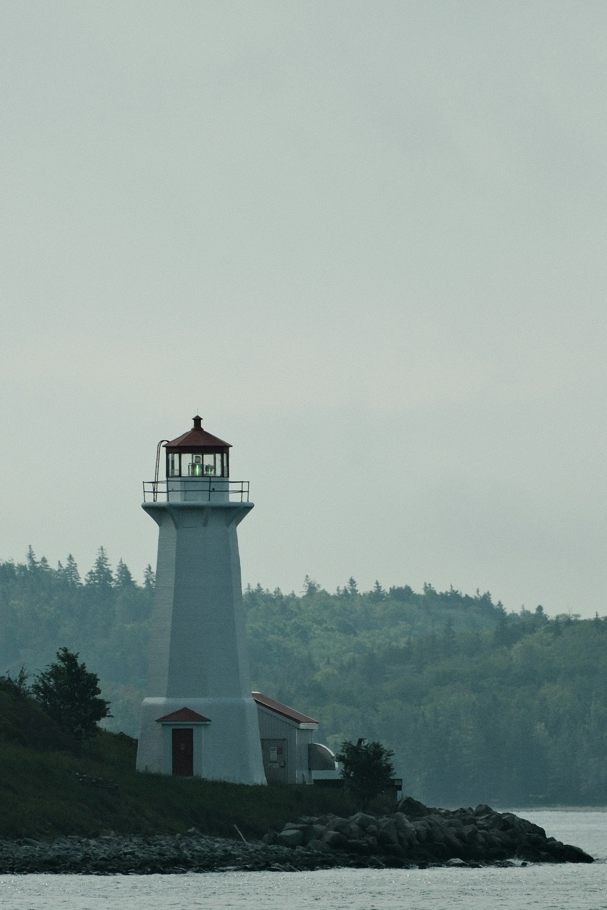

## Research background

I am a marine biologist developing molecular and genomic approaches
to support marine conservation and sustainable fisheries management.

A common thread throughout my research has been the need to build
biological knowledge for species and ecosystems that remain poorly
characterized. I have focused particularly on commercially and
ecologically important marine invertebrates, for which genetic
baselines, curated molecular reference libraries, and genome-wide
resources are often limited.

During my PhD, I developed population-genetic baselines for exploited
marine invertebrates and investigated how genetic information could
support sustainable fisheries management.

During my first postdoctoral fellowship, I expanded this perspective
from individual species to vulnerable marine ecosystems. My work
focused on developing integrative taxonomic and DNA-barcoding resources
to support future environmental DNA (eDNA) monitoring.

## Current position

In April 2025, I joined Daniel Ruzzante’s laboratory at Dalhousie
University in Nova Scotia, Canada, as a Postdoctoral Fellow working
on the Northern Cod Acoustic Tracking (NCAT) project.

Within NCAT, I integrate low-coverage whole-genome sequencing with
acoustic telemetry to investigate relationships between genomic
variation and individual movement patterns in Atlantic cod.

This position builds on my experience with microsatellite and
mitochondrial datasets while extending my expertise into genome-wide
analyses, the computational management of large sequencing datasets,
and the analysis of animal movement and spatial connectivity.

## Looking ahead

My move to Atlantic cod was a deliberate step towards learning in a
system with established genomic resources and acoustic-telemetry
infrastructure.

My long-term aim is to adapt and transfer these approaches to
data-poor marine invertebrates, connecting genomic and ecological
information to address conservation and fisheries-management needs.

## Places connected to my research

My research has taken me to different coastal settings across Spain,
France, and Canada. These photographs show some of the places connected
to that journey.

:::: {.places-grid}

::: {.place-card}
{.place-photo}

### Gueirúa
Cudillero, Asturias, Spain.

::: {.photo-credit}
Photo by [Inés Álvarez Fdez](https://unsplash.com/@powwpic)
on [Unsplash](https://unsplash.com/photos/fBPEXawTQ7c).
:::
:::

::: {.place-card}
{.place-photo}

### Roscoff
Brittany, France.

::: {.photo-credit}
Photo by [Isaline](https://unsplash.com/@pouety)
on [Unsplash](https://unsplash.com/photos/rGceW-U7Vr0).
:::
:::

::: {.place-card}
{.place-photo}

### Cíes
Galicia, Spain.

::: {.photo-credit}
Photo by [A. C.](https://unsplash.com/@3tnik)
on [Unsplash](https://unsplash.com/photos/Cm6_D-A8JO8).
:::
:::

::: {.place-card}
{.place-photo}

### Georges Island
Halifax, Nova Scotia, Canada.

::: {.photo-credit}
Photo by [tonny huang](https://unsplash.com/@tonny_huang)
on [Unsplash](https://unsplash.com/photos/3FitnqauSS8).
:::
:::

::::
